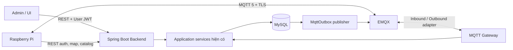
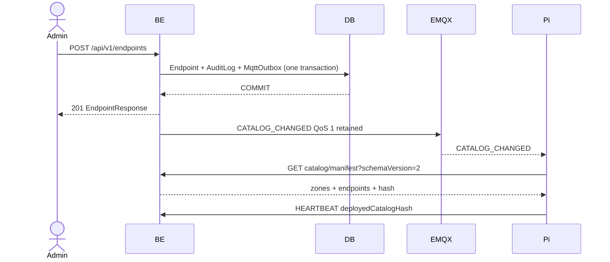

# MQTT BE–Pi và Facility API — Kế hoạch triển khai

> Trạng thái: **PLANNED — chưa triển khai**
>
> Phạm vi: Backend gateway, EMQX, protocol BE–Pi, Facility catalog v2 và kiểm thử tích hợp.
>
> Ngoài phạm vi: ROS/Nav2, driver phần cứng, chương trình điều khiển Pi hoàn chỉnh và giao diện Admin.

## 1. Mục tiêu và quyết định kiến trúc

Backend hiện đã có giao thức Pi qua HTTP `/api/v1/pi/**`, Device JWT, `PiEnvelope`, command polling, heartbeat, location, runtime callback và catalog Endpoint. Facility API cũng đã có CRUD cho Map, Zone, Room, Endpoint và EndpointGroup.

Kế hoạch này bổ sung một cổng MQTT mà không viết lại nghiệp vụ đang hoạt động:

- EMQX cung cấp MQTT 5 cho command, application ACK, runtime event, request, heartbeat và telemetry.
- REST tiếp tục dùng cho cấp Device JWT, tải map, lấy catalog và làm kênh tương thích trong thời gian chuyển đổi.
- HTTP controller và MQTT adapter phải gọi chung application service; không có hai bộ state machine độc lập.
- Admin/UI là nguồn duy nhất được tạo hoặc sửa Zone/Endpoint. Pi chỉ đọc catalog đã duyệt.
- Mỗi thay đổi Facility sau khi commit tạo `CATALOG_CHANGED`; Pi nhận sự kiện rồi tải manifest mới qua REST.
- MySQL là nguồn sự thật. MQTT chỉ là transport, không phải nơi lưu trạng thái Job hoặc Facility.
- Delivery mang tính at-least-once; idempotency dựa trên `messageId` và `operationKey`, không tuyên bố exactly-once.

### 1.1 Kiến trúc đích



Nguyên tắc phân lớp:

1. `controller/pi` chỉ chuyển HTTP request thành lệnh application.
2. `integration/mqtt` parse topic/envelope rồi gọi cùng lệnh application.
3. Application service thực hiện authorization theo robot, validation, idempotency và transaction.
4. Repository lưu domain state, receipt và outbox.
5. MQTT publisher chỉ đọc outbox và phát message; không tự chuyển trạng thái nghiệp vụ.

## 2. Ranh giới MQTT và REST

| Chức năng | Transport chính | Transport tương thích | Ghi chú |
|---|---|---|---|
| Xác thực ban đầu | REST | Không | `POST /api/v1/pi/auth/token`; MQTT dùng device secret trực tiếp qua EMQX authenticator |
| Map metadata/download | REST | Không | Không đưa binary map lên MQTT |
| Catalog đầy đủ | REST | Không | MQTT chỉ phát `CATALOG_CHANGED` |
| Heartbeat/location | MQTT | REST hiện hữu | Telemetry có thể mất mẫu, không retry vô hạn |
| Service request từ Pi | MQTT | REST hiện hữu | Request QoS 1 và application ACK |
| Job/Step callback | MQTT | REST hiện hữu | Cùng state guard và idempotency |
| Dispatch/cancel command | MQTT | HTTP polling | Command không retained; HTTP là fallback |
| SOS/sensing/voice | MQTT | REST hiện hữu | Không thay đổi business contract hiện tại |
| Zone/Endpoint CRUD | REST Admin | Không | Pi không có quyền ghi Facility |

Pi ưu tiên MQTT sau khi kết nối và subscribe thành công. Nếu MQTT mất kết nối liên tục quá 15 giây, Pi được phép quay lại HTTP command polling. Khi MQTT phục hồi, Pi dừng polling sau khi subscription đã được xác nhận. Khoảng giao nhau có thể tạo delivery trùng; `commandId` và `operationKey` phải ngăn tác động vật lý lần hai.

## 3. MQTT namespace và delivery contract

Topic gốc:

```text
mar/v1/robots/{robotCode}
```

`robotCode` trên topic phải khớp username, client ID và robot được tìm thấy trong database. Không dùng UUID do client tự khai báo để quyết định quyền topic.

| Topic suffix | Hướng | QoS | Retained | Payload |
|---|---|---:|---:|---|
| `/up/heartbeat` | Pi → BE | 0 | Không | `PiEnvelope<HeartbeatPayload>` |
| `/up/location` | Pi → BE | 0 | Không | `PiEnvelope<LocationPayload>` |
| `/up/events` | Pi → BE | 1 | Không | Job/Step lifecycle, command ACK, SOS, sensing, voice |
| `/up/requests` | Pi → BE | 1 | Không | Information/navigation/escort request |
| `/presence` | Pi → BE | 1 | Có | Online hoặc Last Will offline |
| `/down/commands` | BE → Pi | 1 | Không | Dispatch/cancel/job-step command |
| `/down/acks` | BE → Pi | 1 | Không | Business ACK/NACK theo `messageId` |
| `/down/catalog` | BE → Pi | 1 | Có | Desired catalog version/hash mới nhất |

### 3.1 Uplink envelope

Giữ nguyên `PiEnvelope<T>` đang có:

```json
{
  "protocolVersion": "1.0",
  "messageId": "3fb003f3-684e-4c40-a558-dd90cf58d381",
  "operationKey": "job-step:7c1b:visit:1",
  "correlationId": "82e2f760-ef28-4bd9-afaf-1fbc405992ba",
  "robotId": "df678c5e-95f9-47b6-bbed-e7666706350f",
  "jobId": null,
  "jobStepId": null,
  "messageType": "HEARTBEAT",
  "occurredAt": "2026-10-08T16:00:00Z",
  "producerSessionId": "1b21d1b8-1da1-4706-896e-d5e17254672c",
  "sequenceNo": 1,
  "payload": {}
}
```

Gateway phải kiểm tra trước khi gọi application service:

- `protocolVersion` được hỗ trợ.
- Topic, authenticated robot và `envelope.robotId` cùng một robot.
- `messageType` thuộc allow-list của topic.
- UUID, timestamp, `sequenceNo`, kích thước payload và JSON shape hợp lệ.
- `occurredAt` không vượt quá 5 phút trong tương lai.
- Payload MQTT tối đa mặc định 256 KiB; map, ảnh, audio và video phải dùng object storage/HTTP URI.
- Field lạ bị từ chối đối với message điều khiển; telemetry có thể cho phép mở rộng theo versioned DTO.

### 3.2 Downlink envelope

Thêm kiểu dùng chung `MqttDownlinkEnvelope<T>`:

```json
{
  "protocolVersion": "1.0",
  "messageId": "51fe470c-ed1b-49b2-8808-e95f36bc82db",
  "correlationId": "82e2f760-ef28-4bd9-afaf-1fbc405992ba",
  "robotId": "df678c5e-95f9-47b6-bbed-e7666706350f",
  "messageType": "DISPATCH_COMMAND",
  "createdAt": "2026-10-08T16:00:01Z",
  "expiresAt": "2026-10-08T16:01:01Z",
  "payload": {}
}
```

- `messageId` của command dùng chính `dispatchCommandId` hoặc `cancelCommandId` đã lưu trong Job.
- `expiresAt` đồng bộ với deadline của command trong database và MQTT message-expiry property.
- Pi từ chối command đã hết hạn nhưng vẫn gửi application ACK với reason `COMMAND_EXPIRED`.
- Command không bao giờ được retained. Broker reconnect không được làm sống lại command cũ ngoài persistent session còn hạn.

### 3.3 Application ACK

Broker PUBACK chỉ xác nhận broker đã nhận packet; nó không chứng minh nghiệp vụ thành công. BE phải gửi ACK riêng trên `/down/acks`:

```json
{
  "protocolVersion": "1.0",
  "messageId": "3fb003f3-684e-4c40-a558-dd90cf58d381",
  "operationKey": "job-step:7c1b:visit:1",
  "correlationId": "82e2f760-ef28-4bd9-afaf-1fbc405992ba",
  "accepted": true,
  "duplicate": false,
  "serverTime": "2026-10-08T16:00:02Z",
  "reasonCode": null,
  "reason": null
}
```

Xử lý lỗi:

- JSON/schema/authorization/business rule không thể retry: lưu receipt `REJECTED`, phát NACK rồi manual-ACK message ở broker để tránh poison loop.
- Lỗi DB, timeout nội bộ hoặc broker tạm thời: không manual-ACK; cho MQTT redelivery.
- Message thành công hoặc trùng đã thành công: trả cùng kết quả đã lưu trong receipt và manual-ACK.
- Không đưa stack trace, SQL, secret hoặc nội dung credential vào NACK.

### 3.4 Message type routing

| Topic | `messageType` được phép | Application service đích |
|---|---|---|
| heartbeat | `HEARTBEAT` | `PiIntegrationService.heartbeat` |
| location | `ROBOT_LOCATION` | `PiIntegrationService.location` |
| events | `COMMAND_ACK`, `JOB_STARTED`, `JOB_RESULT`, `JOB_ERROR`, `STEP_STARTED`, `STEP_RESULT`, `STEP_ERROR`, `CREATE_STEP_VISIT`, `EXECUTE_SERVER_STEP` | Runtime services hiện có |
| events | `SOS`, `DETECTION`, `CROWD_DENSITY`, các voice event đã hỗ trợ | Emergency/Monitoring/Voice services hiện có |
| requests | `INFORMATION_REQUEST`, `NAVIGATION_REQUEST`, `ESCORT_REQUEST` | `ServiceRequestService` hiện có |

Không route bằng tên class Java do client gửi. Registry phải là allow-list tĩnh `messageType → DTO → handler` và fail-closed khi gặp type/version lạ.

## 4. Presence, session và thứ tự message

Pi kết nối với:

- MQTT 5 persistent session; `cleanStart=false`.
- Session expiry mặc định 24 giờ.
- Keep Alive mặc định 15 giây.
- Client ID duy nhất `robot:{robotCode}`; kết nối mới thay thế session cũ của cùng robot.
- Last Will trên `/presence`, QoS 1, retained, payload `OFFLINE` kèm `sessionId` và timestamp.

Sau khi connect, Pi publish retained presence `ONLINE`. Presence chỉ hỗ trợ quan sát kết nối; trạng thái `Robot.OFFLINE` vẫn do heartbeat threshold và scheduler hiện tại quyết định để tránh false offline khi broker/network chập chờn.

`sequenceNo` chỉ tăng trong một `producerSessionId`. Gateway ghi nhận gap hoặc đảo thứ tự để monitoring nhưng không tự bỏ message nghiệp vụ QoS 1 chỉ vì đến lệch thứ tự. State machine trong application service vẫn là lớp quyết định cuối cùng.

## 5. Xác thực và ACL với EMQX

### 5.1 Robot authentication

Pi dùng:

```text
clientId = robot:{robotCode}
username = {robotCode}
password = device secret hiện có
```

EMQX gọi `POST /internal/mqtt/authenticate` trong private Docker network. Request phải có `X-EMQX-Hook-Secret`. Backend:

1. So khớp client ID và username.
2. Tìm Robot không phân biệt hoa thường theo `robotCode`.
3. So password với `device_secret_hash` bằng `PasswordEncoder.matches`.
4. Không cho kết nối khi Robot không có secret hoặc chưa được commission theo policy hiện hành.
5. Trả `is_superuser=false` và ACL gắn đúng robot.

ACL của robot:

```text
ALLOW publish   mar/v1/robots/{robotCode}/up/#
ALLOW publish   mar/v1/robots/{robotCode}/presence
ALLOW subscribe mar/v1/robots/{robotCode}/down/#
DENY  all       #
```

Backend MQTT client dùng credential riêng từ secret manager/environment, được subscribe `mar/v1/robots/+/up/#`, `mar/v1/robots/+/presence` và publish `mar/v1/robots/+/down/#`. Credential này không dùng chung device secret hoặc JWT secret.

### 5.2 Network và secret

- Production chỉ expose TLS listener 8883 cho Pi; 1883 tắt hoặc chỉ nằm trong private network.
- EMQX dashboard không public; local bind loopback, production đi qua VPN/admin network.
- Hook secret, backend MQTT password và TLS private key không commit Git và không ghi log.
- Internal auth endpoint không xuất hiện trong public OpenAPI và từ chối request ngoài trusted proxy/network.
- Device-secret rotation hiện tại có hiệu lực ở lần MQTT reconnect tiếp theo; có thể chủ động disconnect client cũ qua EMQX management API sau khi rotate.

## 6. Lưu bền và idempotency

Không sửa V1–V16. Migration triển khai đầu tiên là `V17__create_mqtt_gateway_schema.sql`.

### 6.1 Bảng `MqttOutbox`

| Cột | Kiểu/constraint | Ý nghĩa |
|---|---|---|
| `mqtt_outbox_id` | `BINARY(16)` PK | Đồng thời là MQTT message ID nếu phù hợp |
| `robot_id` | FK `Robot`, not null | Robot nhận message |
| `aggregate_type` | `VARCHAR(64)` | JOB, FACILITY_CATALOG... |
| `aggregate_id` | `BINARY(16)` nullable | ID domain liên quan |
| `message_type` | `VARCHAR(100)` | DISPATCH_COMMAND, CATALOG_CHANGED... |
| `topic` | `VARCHAR(255)` | Topic đã resolve, không nhận từ client |
| `qos` | `TINYINT` check 0..1 | Không dùng QoS 2 trong v1 |
| `is_retained` | `BOOLEAN` | Chỉ catalog desired-state được retained |
| `payload_json` | `JSON` | Downlink envelope hoàn chỉnh |
| `status` | `VARCHAR(16)` | PENDING, PROCESSING, PUBLISHED, DEAD |
| `attempt_count` | `INT` | Số lần publish |
| `available_at` | `DATETIME(6)` | Backoff deadline |
| `lock_owner`, `locked_until` | nullable | Lease cho nhiều BE instance |
| `last_error_code` | nullable | Mã lỗi đã sanitize |
| `published_at`, `created_at` | timestamp | Audit vận hành |

Index tối thiểu: `(status, available_at)`, `(robot_id, created_at)`, `(aggregate_type, aggregate_id)` và unique phù hợp cho một domain message. Không lưu broker password hoặc TLS material.

### 6.2 Bảng `MqttMessageReceipt`

| Cột | Kiểu/constraint | Ý nghĩa |
|---|---|---|
| `message_id` | `BINARY(16)` PK | Idempotency key của uplink |
| `robot_id` | FK `Robot`, not null | Chủ message |
| `producer_session_id` | `BINARY(16)` | Phiên Pi |
| `sequence_no` | `BIGINT` | Theo dõi thứ tự |
| `message_type` | `VARCHAR(100)` | Type đã route |
| `payload_hash` | `CHAR(64)` | SHA-256 của canonical payload |
| `status` | `VARCHAR(16)` | PROCESSING, ACCEPTED, REJECTED |
| `response_json` | `JSON` nullable | ACK/NACK để replay nhất quán |
| `received_at`, `processed_at` | timestamp | Audit/latency |

Nếu cùng `messageId` nhưng khác robot, message type hoặc payload hash thì trả conflict và tạo security log. Receipt và domain mutation phải commit cùng transaction. HTTP và MQTT vẫn giữ các idempotency guard domain hiện có để message đi chéo transport không gây tác động lặp.

### 6.3 Outbox publisher

- Worker lấy batch bằng pessimistic lock/`SKIP LOCKED`, đặt lease ngắn rồi publish ngoài transaction giữ lock.
- Chỉ đánh dấu `PUBLISHED` sau MQTT PUBACK.
- Retry exponential backoff có jitter; cấu hình max attempts, batch size và lock duration.
- Lease hết hạn cho phép instance khác nhận lại message.
- Quá max attempts chuyển `DEAD`, tạo metric/alert; không tự xóa hoặc giả thành công.
- Command quá `expiresAt` chuyển `DEAD` với `COMMAND_EXPIRED`, không publish muộn.
- Cleanup chỉ xóa receipt/outbox đã thành công theo retention setting; bản ghi DEAD giữ đến khi operator xử lý.

## 7. Facility API và validation

### 7.1 API Admin giữ nguyên

| Method | Route | Quyền | Mục đích |
|---|---|---|---|
| `POST` | `/api/v1/zones` | ADMIN | Tạo Zone |
| `PUT` | `/api/v1/zones/{id}` | ADMIN | Sửa Zone |
| `POST` | `/api/v1/zones/{id}/activate` | ADMIN | Kích hoạt |
| `POST` | `/api/v1/zones/{id}/deactivate` | ADMIN | Vô hiệu hóa |
| `POST` | `/api/v1/endpoints` | ADMIN | Tạo Endpoint |
| `PUT` | `/api/v1/endpoints/{id}` | ADMIN | Sửa Endpoint |
| `POST` | `/api/v1/endpoints/{id}/activate` | ADMIN | Kích hoạt |
| `POST` | `/api/v1/endpoints/{id}/deactivate` | ADMIN | Vô hiệu hóa |

Không thêm MQTT message cho phép Pi tạo/sửa/xóa Facility.

API list được mở rộng tương thích ngược:

```text
GET /api/v1/zones?mapId=&active=&page=&size=
GET /api/v1/endpoints?mapId=&zoneId=&roomId=&active=&page=&size=
```

Tham số mới đều optional; request cũ tiếp tục trả danh sách phân trang như hiện tại.

### 7.2 Zone polygon

`polygonJson` v1 dùng map-frame meter:

```json
{
  "frameId": "map",
  "points": [
    {"xM": 1.2, "yM": 2.0},
    {"xM": 4.8, "yM": 2.0},
    {"xM": 4.8, "yM": 6.1},
    {"xM": 1.2, "yM": 6.1}
  ]
}
```

Validation bắt buộc:

- `frameId` bằng frame của Map.
- Có ít nhất ba điểm phân biệt; backend tự coi cạnh cuối nối về điểm đầu, không yêu cầu lặp điểm đầu.
- Tọa độ là số hữu hạn, precision phù hợp schema, polygon có diện tích lớn hơn 0 và không tự cắt.
- `speedLimitMps`, `capacityLimit`, camera ROI tiếp tục theo contract hiện hữu.
- `zoneCode` unique không phân biệt hoa thường trong một Map.

### 7.3 Endpoint

- Endpoint, Zone phải cùng Map.
- Room nếu có phải thuộc cùng Floor với Map.
- Nếu có `zoneId`, điểm `(xM,yM)` phải nằm trong hoặc trên biên polygon của Zone.
- `yawRad` nằm trong `[-π, π]` như validation hiện tại.
- `endpointCode` unique không phân biệt hoa thường trong một Map.
- Không hard-delete dữ liệu đang được Job/Request/history tham chiếu; dùng active/deactivate.

## 8. Facility catalog schema v2

Giữ nguyên response hiện tại khi không truyền version:

```text
GET /api/v1/pi/catalog/manifest
```

Thêm:

```text
GET /api/v1/pi/catalog/manifest?schemaVersion=2
```

Catalog v2 gồm:

```json
{
  "protocolVersion": "1.0",
  "catalogSchemaVersion": 2,
  "robotId": "df678c5e-95f9-47b6-bbed-e7666706350f",
  "mapId": "d579c136-2781-47c7-840a-4cd6e2db2a3d",
  "mapVersion": 3,
  "mapHash": "sha256...",
  "expectedCatalogHash": "sha256...",
  "zones": [
    {
      "zoneId": "...",
      "zoneCode": "WARD_A",
      "zoneType": "CORRIDOR",
      "polygon": {},
      "speedLimitMps": 0.6,
      "capacityLimit": 20,
      "active": true,
      "publicVisible": true
    }
  ],
  "endpoints": [
    {
      "endpointId": "...",
      "endpointCode": "ROOM_101_DOOR",
      "endpointType": "ROOM_STOP",
      "zoneId": "...",
      "roomId": "...",
      "xM": 3.25,
      "yM": 4.10,
      "yawRad": 1.570796,
      "active": true,
      "accessible": true
    }
  ]
}
```

Hash catalog v2:

- Chỉ gồm field Pi cần thực thi; không đưa description/audit timestamp vào hash.
- Sort Zone theo `zoneCode`, sau đó ID; sort Endpoint theo `endpointCode`, sau đó ID.
- JSON canonical dùng UTF-8, key order cố định, UUID lowercase và decimal normalized.
- Hash bằng SHA-256; cùng dữ liệu luôn cho cùng hash trên mọi instance.
- V1 tiếp tục dùng hash endpoint-only hiện tại; không so hash chéo schema version.

### 8.1 Catalog changed

Trong cùng transaction tạo/sửa/activate/deactivate Zone hoặc Endpoint, sau khi entity đã được flush:

1. Xác định Map bị ảnh hưởng.
2. Tính catalog hash v2 từ transaction snapshot sắp được commit.
3. Tạo một outbox message cho từng Robot đang gán Map đó.
4. Sau khi transaction commit, publisher gửi retained `/down/catalog`:

```json
{
  "protocolVersion": "1.0",
  "messageId": "...",
  "correlationId": "...",
  "robotId": "...",
  "messageType": "CATALOG_CHANGED",
  "createdAt": "2026-10-08T16:00:00Z",
  "expiresAt": null,
  "payload": {
    "catalogSchemaVersion": 2,
    "mapId": "...",
    "mapVersion": 3,
    "expectedCatalogHash": "sha256...",
    "reason": "ENDPOINT_UPDATED"
  }
}
```

Pi so sánh hash. Nếu khác, Pi gọi REST manifest v2, validate toàn bộ, ghi atomically vào local catalog rồi gửi hash mới trong heartbeat. Không cập nhật `deployedCatalogHash` chỉ vì đã nhận MQTT event.



## 9. Thành phần dự kiến triển khai

### 9.1 Dependency và configuration

- Thêm `spring-integration-mqtt` và Paho MQTT v5 client; version Spring Integration theo Spring Boot BOM, Paho được pin và kiểm tra CVE.
- `MqttProperties`: enabled, broker URIs, client ID, username/password, TLS, topic prefix, payload limit, reconnect, session expiry, outbox batch/retry.
- Tách config local/test/production; không có secret mặc định dùng được ở production.
- Thêm EMQX service, persistent data/log volumes và healthcheck trong Compose.

Biến môi trường dự kiến:

```text
MQTT_ENABLED
MQTT_BROKER_URIS
MQTT_BACKEND_CLIENT_ID
MQTT_BACKEND_USERNAME
MQTT_BACKEND_PASSWORD
MQTT_TOPIC_PREFIX
MQTT_TLS_ENABLED
MQTT_TRUST_STORE_PATH
MQTT_TRUST_STORE_PASSWORD
MQTT_HOOK_SECRET
MQTT_MAX_PAYLOAD_BYTES
MQTT_OUTBOX_BATCH_SIZE
MQTT_OUTBOX_MAX_ATTEMPTS
```

### 9.2 Module Backend

- `integration/mqtt/config`: client factory, inbound/outbound flow, error channel và health indicator.
- `integration/mqtt/security`: EMQX authentication response và topic ACL.
- `integration/mqtt/message`: downlink, ACK/NACK, catalog event và presence DTO.
- `integration/mqtt/router`: topic parser, envelope validator và allow-list message registry.
- `integration/mqtt/outbox`: transactional writer, publisher, retry/dead handling.
- `integration/mqtt/inbox`: receipt/idempotency coordinator.
- Facility service gọi catalog outbox writer trong cùng transaction; không publish trực tiếp từ controller.

## 10. Phân chia phase triển khai code

Không triển khai toàn bộ MQTT, Facility validation và command routing trong một lần. Chương trình được chia thành tám phase `MQTT-0` đến `MQTT-7`; mỗi phase có phạm vi file, migration và test gate riêng. `MQTT-*` là mã workstream, không thay thế số Phase nghiệp vụ Backend hiện có.

| Phase | Mục tiêu | Phụ thuộc | Có được bật production? |
|---|---|---|---|
| MQTT-0 | Khóa contract và test fixture | Backend Phase 18 | Không |
| MQTT-1 | EMQX, configuration, authentication và ACL | MQTT-0 | Chỉ local/test |
| MQTT-2 | Receipt, outbox và publisher bền vững | MQTT-1 | Chưa route business message |
| MQTT-3 | Presence, heartbeat và location inbound | MQTT-2 | Pilot telemetry |
| MQTT-4 | Facility validation, catalog v2 và catalog event | MQTT-2, MQTT-3 | Pilot catalog |
| MQTT-5 | Request và business/runtime event inbound | MQTT-3 | Pilot theo message type |
| MQTT-6 | Command downlink và HTTP fallback | MQTT-2, MQTT-5 | Pilot robot allow-list |
| MQTT-7 | Hardening, tải, runbook và hardware acceptance | MQTT-4, MQTT-6 | Mở rộng sau nghiệm thu |

### 10.1 MQTT-0 — Khóa contract và bộ khung test

**Mục tiêu:** biến tài liệu này thành contract có fixture máy đọc được trước khi nối broker.

- Chốt topic, QoS, retained, envelope, message type registry, reason code và catalog schema v2.
- Tạo JSON fixture hợp lệ/không hợp lệ cho heartbeat, location, runtime event, request, command, ACK và catalog event.
- Tạo DTO/downlink types và validator thuần, chưa tạo MQTT connection.
- Tạo topic parser/builder duy nhất; cấm ghép topic bằng string rải rác trong service.
- Bổ sung ADR ngắn ghi quyết định hybrid MQTT + REST và nguyên tắc MySQL là nguồn sự thật.

**Test gate:** DTO serialization, unknown field/type, topic parsing, version validation và payload-size validation đều pass. Full regression hiện tại phải giữ nguyên.

**Bàn giao:** một commit độc lập, gợi ý `docs(mqtt): freeze gateway protocol contract` hoặc `feat(mqtt): add protocol contracts` nếu đã có code DTO.

### 10.2 MQTT-1 — Broker, configuration và security boundary

**Mục tiêu:** Pi simulator kết nối được EMQX với ACL đúng, nhưng chưa được tác động domain state.

- Thêm dependency Spring Integration MQTT/Paho v5, `MqttProperties` và feature flag `MQTT_ENABLED=false` mặc định.
- Thêm EMQX vào Compose với volume, healthcheck và listener local; tạo cấu hình TLS riêng cho production.
- Thêm internal HTTP authenticator, hook-secret filter và ACL response.
- Tạo Backend MQTT service account; không dùng chung Robot/device credential.
- Tạo health indicator chỉ phản ánh MQTT component, không làm REST mất availability.

**Test gate:** Robot hợp lệ connect; sai secret/client ID bị từ chối; Robot A không thể publish/subscribe topic Robot B; backend service account chỉ có quyền gateway cần thiết; không có secret trong Git/log.

**Bàn giao:** Compose chạy được `MySQL + Backend + EMQX`; chưa subscribe business topic khi feature flag tắt.

### 10.3 MQTT-2 — Persistence, inbox/outbox và delivery engine

**Mục tiêu:** có nền tảng delivery bền vững trước khi route message thật.

- Thêm duy nhất migration forward `V17__create_mqtt_gateway_schema.sql` cho `MqttOutbox` và `MqttMessageReceipt`.
- Thêm entity/repository, receipt coordinator, transactional outbox writer và batch publisher.
- Hỗ trợ lease, `SKIP LOCKED`, PUBACK, retry/backoff, command expiry và trạng thái DEAD.
- Thêm scheduler/worker sau feature flag; không publish trực tiếp từ controller hoặc domain service.
- Thêm metric outbox/receipt và retention setting, mặc định không xóa DEAD record.

**Test gate:** fresh migration V1–V17, Hibernate validate, duplicate receipt, payload collision, concurrent publisher, lease recovery, broker outage/reconnect và crash-after-publish đều pass.

**Bàn giao:** có thể enqueue/publish một test message kỹ thuật; chưa bật Facility hoặc Job command.

### 10.4 MQTT-3 — Presence và telemetry inbound

**Mục tiêu:** đưa luồng ít rủi ro lên MQTT trước để kiểm chứng gateway.

- Subscribe presence, heartbeat và location; dùng manual acknowledgement và bounded executor.
- Adapter tạo `DevicePrincipal` nội bộ từ authenticated topic identity, không tin `robotId` trong payload.
- Route heartbeat/location vào đúng application service đang được HTTP controller dùng.
- Lưu receipt cùng domain transaction; ACK duplicate nhất quán.
- Presence/LWT chỉ tạo connection metric/event, không trực tiếp đổi Robot thành OFFLINE.

**Test gate:** MQTT-03, MQTT-04, MQTT-05, MQTT-06, MQTT-07 và MQTT-12; so sánh database state giữa cùng payload gửi HTTP và MQTT.

**Bàn giao:** chỉ robot allow-list dùng MQTT telemetry; HTTP telemetry vẫn hoạt động.

### 10.5 MQTT-4 — Facility API và catalog v2

**Mục tiêu:** hoàn thiện dữ liệu Zone/Endpoint và đồng bộ catalog mà không trộn với Job command.

- Bổ sung filter list API, polygon validator, point-in-polygon và Map/Zone/Room consistency.
- Tách `FacilityCatalogService` tạo manifest/hash để REST và outbox cùng dùng một implementation.
- Thêm manifest v2; giữ nguyên response v1 khi không truyền `schemaVersion`.
- Facility service ghi audit, mutation và `CATALOG_CHANGED` outbox trong cùng transaction.
- Chỉ publisher gửi retained event sau commit; rollback không để lại outbox.

**Test gate:** FAC-01 đến FAC-05, CAT-01 đến CAT-03; hash không đổi khi repository trả thứ tự khác; robot ngoài Map không nhận catalog event.

**Bàn giao:** Pi simulator nhận event, tải v2, validate và báo `deployedCatalogHash` trong heartbeat.

### 10.6 MQTT-5 — Request và runtime/business event inbound

**Mục tiêu:** chuyển các callback QoS 1 sau khi inbox/outbox và telemetry đã ổn định.

- Mở message registry từng nhóm: ServiceRequest, command ACK, Job lifecycle, Step lifecycle, SOS, sensing rồi voice.
- Mỗi handler chỉ chuyển DTO sang application command; state transition, scope và idempotency vẫn nằm trong service hiện có.
- ACK/NACK được ghi receipt và phát qua `/down/acks`.
- Mỗi nhóm message có feature flag/allow-list riêng để rollback độc lập.
- Không bật type tiếp theo nếu type trước chưa đạt integration test và regression.

**Test gate:** valid/invalid state, sai robot/job/step, duplicate, out-of-order, expired callback, reboot/recovery và HTTP/MQTT cross-transport duplicate.

**Bàn giao:** toàn bộ uplink business contract chạy qua simulator; HTTP endpoints vẫn tương thích.

### 10.7 MQTT-6 — Command downlink và fallback

**Mục tiêu:** chuyển dispatch/cancel command cuối cùng vì đây là phần có rủi ro tác động vật lý cao nhất.

- Khi tạo dispatch/cancel, ghi command state và outbox cùng transaction.
- Publish `/down/commands` QoS 1, non-retained, có message expiry khớp database.
- Pi deduplicate bằng `commandId + operationKey`, persist trước khi điều khiển hardware và ACK kết quả.
- HTTP `/commands/next` vẫn là fallback sau MQTT disconnect quá 15 giây.
- Backend chấp nhận ACK trùng từ hai transport nhưng chỉ có một state transition.
- Chỉ bật theo robot allow-list; kill switch phải tắt downlink mà không rollback migration.

**Test gate:** MQTT-08 đến MQTT-11, duplicate delivery, broker/backend/Pi restart, expired command, cancel race và một tác động vật lý cho một operation.

**Bàn giao:** simulator pass trước; robot thật chỉ pilot sau hardware checklist.

### 10.8 MQTT-7 — Hardening và nghiệm thu

**Mục tiêu:** chứng minh gateway vận hành được, không chỉ chạy happy path.

- Chạy full regression, security test, 20-robot simulator, failure injection và backup/restore.
- Hoàn thiện dashboard/alert, TLS certificate runbook, credential rotation, DEAD outbox handling và retained-topic cleanup.
- Kiểm tra resource limit, graceful shutdown, reconnect storm và nhiều Backend instance.
- Chạy hardware acceptance; lưu evidence theo Job/command/message/correlation ID.
- Chỉ sau phase này mới cân nhắc bật rộng ngoài pilot allow-list.

**Test gate:** toàn bộ matrix mục 12, không skip âm thầm; mọi gap còn lại phải ghi rõ owner và trạng thái.

### 10.9 Quy tắc giữ code không bị rối

- Mỗi phase là một PR/commit chain riêng; không gộp Facility, runtime callback và command downlink trong cùng PR.
- Phase sau chỉ bắt đầu khi test gate phase trước xanh và contract không còn OPEN decision.
- HTTP controller và MQTT adapter không chứa business rule; cả hai gọi chung application service.
- Chỉ một topic builder, một message registry, một catalog hasher và một outbox writer.
- Không gọi MQTT client trong transaction nghiệp vụ; transaction chỉ ghi outbox.
- Không sửa migration V1–V16; V17 thuộc MQTT-2 và không được tạo trước ở phase khác.
- Feature flag mặc định off; enable theo message group và robot allow-list.
- Sau mỗi phase cập nhật tài liệu này với trạng thái `PLANNED/IN_PROGRESS/DONE`, commit, test evidence và gap còn lại.

## 11. Observability và vận hành

Metrics tối thiểu:

```text
mqtt_connected
mqtt_reconnect_total
mqtt_inbound_total{topic,type,result}
mqtt_outbound_total{type,result}
mqtt_validation_failure_total{reason}
mqtt_outbox_pending
mqtt_outbox_dead
mqtt_outbox_oldest_age_seconds
mqtt_processing_duration_seconds{type}
```

- Log có `messageId`, `correlationId`, robot ID/code, type và result; không log raw password/token.
- MQTT broker down làm readiness của MQTT component `DEGRADED`, không kéo toàn bộ REST API thành unavailable.
- Alert khi backend mất broker connection kéo dài, outbox DEAD > 0 hoặc tuổi PENDING vượt command SLA.
- Runbook phải có rotate credential, certificate renewal, replay outbox DEAD có kiểm soát, clear retained catalog khi decommission robot và backup/restore EMQX data.

## 12. Kế hoạch kiểm thử

### 12.1 Unit test

- Parse đúng/sai topic và robot code.
- Envelope/topic/type mismatch bị từ chối.
- ACL chỉ cho đúng namespace robot.
- Payload size, timestamp, sequence và protocol version.
- Canonical catalog hash ổn định khi database trả thứ tự khác nhau.
- Polygon hợp lệ, thiếu điểm, diện tích 0, tự cắt; Endpoint ngoài Zone.
- Backoff, lease expiry, max attempts và command expiry.
- Duplicate receipt trả cùng ACK, payload collision trả conflict.

### 12.2 Integration test MySQL + EMQX

| Mã | Kịch bản | Kết quả bắt buộc |
|---|---|---|
| MQTT-01 | Robot hợp lệ connect | Auth thành công, ACL đúng robot |
| MQTT-02 | Robot A publish/subscribe topic Robot B | Broker từ chối |
| MQTT-03 | Heartbeat/location hợp lệ | Domain state giống HTTP contract |
| MQTT-04 | QoS 1 redelivery cùng message | Một domain mutation, ACK duplicate |
| MQTT-05 | Cùng message ID nhưng payload khác | Conflict/security event |
| MQTT-06 | DB lỗi tạm thời | Không ACK broker, redelivery xử lý được |
| MQTT-07 | Validation lỗi vĩnh viễn | NACK sanitized, không poison loop |
| MQTT-08 | Broker down khi commit command | Outbox còn PENDING, reconnect publish thành công |
| MQTT-09 | Backend crash sau publish trước update | Có thể publish lại, Pi không thực thi lặp |
| MQTT-10 | Command hết hạn | Không publish/thực thi muộn |
| MQTT-11 | Reconnect persistent session | Message QoS 1 còn hạn được nhận |
| MQTT-12 | Last Will | Presence offline xuất hiện; scheduler vẫn là nguồn trạng thái chuẩn |
| FAC-01 | Tạo Zone hợp lệ | 201, audit và catalog event sau commit |
| FAC-02 | Polygon sai | 400/422, không outbox |
| FAC-03 | Endpoint khác Map/Room Floor | 422, rollback toàn bộ |
| FAC-04 | Endpoint ngoài Zone | 422, không thay catalog hash |
| FAC-05 | Update/deactivate Facility | Chỉ robot trên Map liên quan nhận event |
| CAT-01 | Manifest v1 | Response cũ không đổi |
| CAT-02 | Manifest v2 | Đủ Zone/Endpoint và hash canonical đúng |
| CAT-03 | Facility transaction rollback | Không có `CATALOG_CHANGED` |
| COMP-01 | HTTP Pi API hiện hữu | Regression vẫn pass |

### 12.3 Acceptance và tải

- Simulator tối thiểu 20 robot chạy đồng thời: heartbeat 10 giây, location tối đa 1 Hz và runtime QoS 1.
- Không mất message nghiệp vụ QoS 1 sau broker/backend restart có kiểm soát.
- Không có command vật lý bị áp dụng hai lần trong duplicate/reconnect test.
- Đo publish-to-consume latency và outbox drain rate; ghi số thực tế, không tuyên bố SLA chưa được phê duyệt.
- Hardware acceptance với Pi thật phải lưu JSON đã che secret, MQTT packet timeline, JobEvent, log Pi/ROS và kết quả quan sát vật lý.

## 13. Rollout

### Giai đoạn A — Broker và contract

- Dựng EMQX, TLS, HTTP authenticator/ACL, Backend MQTT client và Pi simulator.
- Hoàn tất schema V17, receipt/outbox, monitoring và security test.
- Chưa chuyển command production sang MQTT.

### Giai đoạn B — Inbound MQTT

- Bật heartbeat, location và event uplink theo từng robot thử nghiệm.
- So sánh kết quả MQTT với HTTP contract; giữ HTTP fallback.
- Bật catalog v2 và `CATALOG_CHANGED` cho robot có capability phù hợp.

### Giai đoạn C — Command MQTT

- Bật downlink command cho robot thử nghiệm sau duplicate/hardware acceptance.
- Pi dùng MQTT chính, polling HTTP chỉ khi disconnect quá 15 giây.
- Mở rộng theo nhóm robot; có feature flag/allow-list để rollback transport mà không rollback schema.

Rollback transport chỉ tắt MQTT routing và cho Pi quay về HTTP. Không xóa outbox/receipt và không sửa ngược migration đã áp dụng.

## 14. Definition of Done

Chỉ đánh dấu MQTT gateway hoàn tất khi:

- EMQX authentication, ACL và TLS pass; robot không thể đọc/ghi topic robot khác.
- HTTP và MQTT dùng chung business service/state machine.
- Outbox chịu được broker outage/backend restart; receipt ngăn duplicate domain effect.
- Command không retained, có expiry và không gây tác động vật lý lặp.
- Facility API validate Zone/Endpoint đúng quan hệ Map/Room/polygon.
- Catalog v1 tương thích; catalog v2 có Zone, Endpoint và hash ổn định.
- Facility commit tạo đúng `CATALOG_CHANGED`; rollback không phát event.
- Full regression hiện hữu và test MQTT/Facility mới đều pass trên MySQL thật và EMQX container.
- Compose, environment template, monitoring và runbook đã được cập nhật nhưng không chứa secret.
- Pi simulator acceptance pass; phần điều khiển hardware chỉ DONE sau acceptance với Pi thật.

## 15. Tài liệu kỹ thuật tham chiếu

- [Spring Integration MQTT Support](https://docs.spring.io/spring-integration/reference/mqtt.html)
- [EMQX HTTP Authentication](https://docs.emqx.com/en/emqx/latest/guides/access-control/authn/http.html)
- [EMQX HTTP Authorization](https://docs.emqx.com/en/emqx/latest/guides/access-control/authz/http.html)
- [EMQX Docker Deployment](https://docs.emqx.com/en/emqx/latest/get-started/deploy/install-docker.html)
